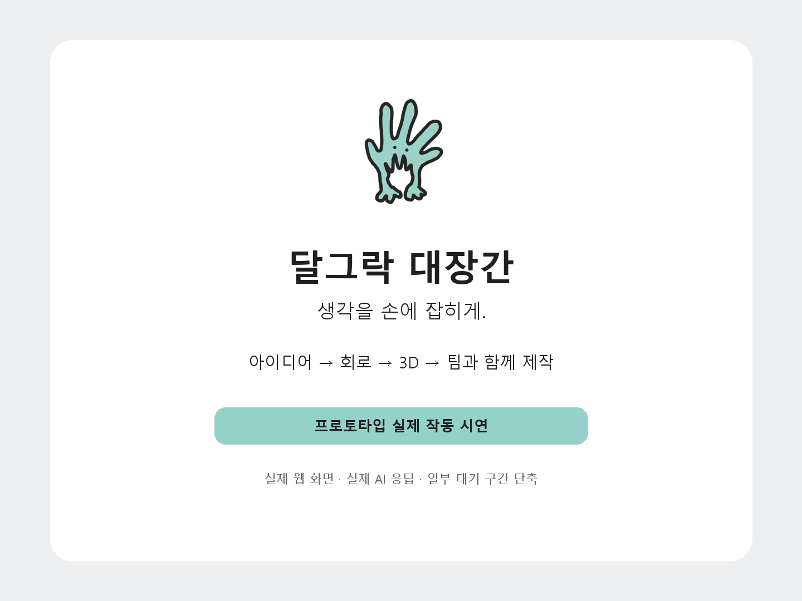
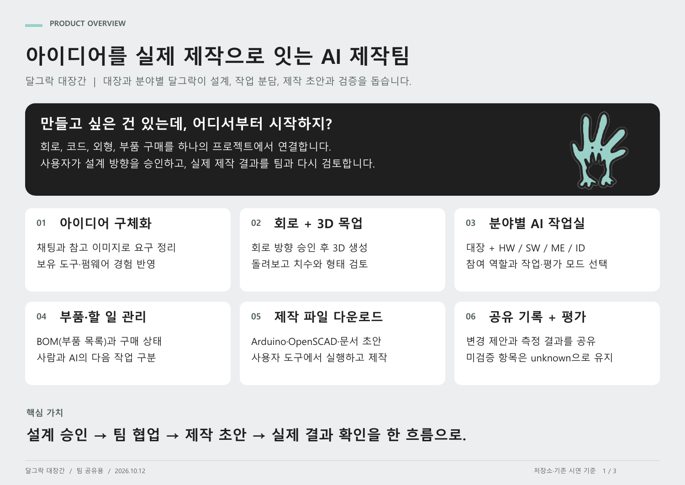
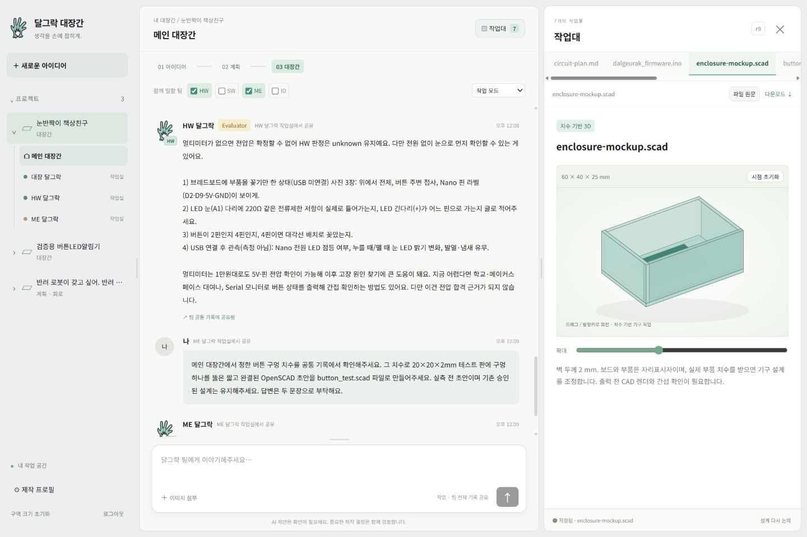

<p align="center">
  
</p>

<h1 align="center">달그락 대장간</h1>

<p align="center">
  <b>생각을 손에 잡히게.</b><br>
  아이디어를 실제 하드웨어로 만들 수 있도록, AI 제작팀이 설계부터 제작·검증까지 함께하는 웹앱
</p>

<p align="center">
  <a href="artifacts/demo/dalgeurak-demo.mp4"></a><br>
  <sub>▲ 이미지를 누르면 약 2분짜리 시연 영상을 볼 수 있어요</sub>
</p>

---

## 이런 분을 위해 만들었어요

> “만들고 싶은 건 있는데, 어디서부터 시작하지?”

일하다 보면 **‘이런 물건 있으면 좋겠다’** 싶은 순간이 있습니다. 표면에 대면 색을 저장하는 컬러 수집기, 교실이 시끄러워지면 불이 켜지는 신호등, 내 몸에 맞춘 작은 보조 기기 같은 것들이요.

그런데 막상 만들려고 하면 회로, 코드, 3D 모델링, 부품 구매까지 서로 다른 분야를 한꺼번에 알아야 합니다. 검색과 강의는 부품 하나하나는 알려줘도, **“내가 만들고 싶은 것”을 처음부터 끝까지 완성하는 길**은 알려주지 않죠.

달그락 대장간은 **전공자가 아니어도, 팀이 없어도** 아이디어를 실제 시제품까지 가져갈 수 있도록 돕습니다. 바이브 코딩처럼 하드웨어를 만들어보려는 사람, 우리는 그들을 **‘바이브 포저(Vibe Forger)’** 라고 부릅니다.

## 어떻게 생겨났나요

만든 사람도 정치학을 전공한 비전공자입니다. 아두이노가 무엇인지도 모르던 상태에서, 직접 쓰기 위한 재활 보조 인솔 **Onyx SDI**를 AI와 함께 혼자 39일 만에, 약 12만 원으로 만들었습니다.

그 과정에서 효과가 있었던 방법이 세 가지였어요.

1. **모르는 건 AI에게 배우면서 설계하기**
2. **회로·코드·기구·디자인을 분야별 AI에게 나눠 맡기고, AI끼리 인수인계하게 하기**
3. **부품을 사기 전에, 만든 AI와 다른 AI가 설계를 검토하기**

달그락 대장간은 이 방법을 누구나 쓸 수 있도록 하나의 서비스로 옮긴 것입니다.

<p align="center">
  
</p>

## 무엇을 할 수 있나요

| 단계 | 하는 일 |
|---|---|
| **01 아이디어** | 머릿속 아이디어를 말이나 참고 이미지로 들려주면, 대장 달그락이 빠진 부분을 질문하며 함께 구체화합니다. 가진 도구와 경험도 알려주면 그 수준에 맞춰 설명해요. |
| **02 계획** | 먼저 **회로**를 제안합니다. 회로 방향을 승인하면 **3D 목업**이 만들어지고, 마우스로 돌려보며 크기와 형태를 확인할 수 있어요. |
| **03 대장간** | 필요한 **부품 목록(BOM)** 과 **사람이 할 일 / AI가 할 일**을 정리한 뒤, 분야별 달그락 팀과 함께 실제 제작에 들어갑니다. |

### 분야별 AI 팀, ‘달그락’

| 달그락 | 맡는 일 |
|---|---|
| **대장** | 전체 목표와 일정, 팀원 사이의 순서를 조율합니다 |
| **HW** | 회로와 펌웨어(보드에 올리는 코드) |
| **SW** | 데이터를 보여줄 웹·앱 |
| **ME** | 부품을 담을 케이스, 구조와 배치 |
| **ID** | 겉모습과 쓰기 편한지, 착용감과 안전 |

각 달그락은 두 가지 모드로 일합니다.

- **작업 모드**: 설계안, 코드, 3D 파일 같은 결과물을 만듭니다.
- **평가 모드(Evaluator)**: 만든 결과를 검토하고, 문제가 있으면 “멀티미터로 이 지점 전압을 재주세요”처럼 **사람이 확인해야 할 것**을 구체적으로 요청합니다.

한 방에서 정한 변경 사항(예: 버튼 구멍을 8mm로)은 **팀 공통 기록**에 남아서, 다른 달그락도 같은 정보를 보고 이어서 작업합니다.

<p align="center">
  <br>
  <sub>▲ 메인 대장간. 가운데에서 달그락 팀과 대화하고, 오른쪽 ‘작업대’에서 회로·펌웨어·3D 파일을 확인하고 내려받아요.</sub>
</p>

## 달그락 대장간이 지키는 원칙

- **결정은 사람이 합니다.** 회로와 3D는 사용자가 승인해야 다음 단계로 넘어가고, 한 번 승인한 설계는 대화만으로 바뀌지 않습니다.
- **확인하지 않은 건 ‘모름’으로 둡니다.** 실제로 재보거나 실행해보지 않은 항목은 통과로 처리하지 않고 `unknown`으로 남깁니다.
- **사람의 손이 필요한 일은 사람에게 맡깁니다.** 부품 구매, 납땜, 측정, 보드에 코드 올리기는 사람이 하고, AI는 그 결과를 받아 다음 수정을 돕습니다.
- **틀리기 전에 먼저 걸러냅니다.** 하드웨어는 틀리면 부품을 다시 사야 하니까, 만드는 AI와 검토하는 AI를 나눠 둡니다.

## 지금 할 수 있는 것과 아직 안 되는 것

지금은 **1차 MVP** 단계로, 만든 사람의 컴퓨터에서 돌아가는 개인용 버전입니다. 아직 누구나 접속할 수 있는 웹사이트로 공개하지는 않았어요.

| 지금 됨 ✅ | 아직 안 됨 ⏳ |
|---|---|
| 아이디어 대화, 참고 이미지 첨부 | 실시간 부품 재고·가격 검색 (구매 전 직접 확인하도록 안내) |
| 회로 제안과 승인, 돌려볼 수 있는 3D 목업 | 실제 부품 형상까지 반영한 정밀 CAD·STL 출력 |
| 부품 목록, 사람/AI 할 일, 구매 상태 기록 | 앱에서 보드로 코드 바로 올리기 (지금은 Arduino IDE에서 직접) |
| 분야별 작업실과 평가 모드, 팀 공통 기록 | 여러 사람이 함께 쓰는 계정, 클라우드 저장 |
| 펌웨어·OpenSCAD·문서 초안 내려받기 | 사진을 보고 고장 원인을 찾아주는 기능 |

## 앞으로의 계획

1. **1차 (지금)**: 아이디어를 넣으면 목업·명세서·작업 순서를 눈으로 보여주기
2. **사진 기반 디버깅**: 문제가 생기면 AI가 “이 각도에서 이 부분을 찍어주세요”처럼 필요한 사진을 요청하고 함께 원인 찾기
3. **웹 안의 에이전트**: 명세서 작성부터 실제 작업까지 앱 안에서 이어서 진행
4. **배우면서 만들기**: 아이디어에서 내가 아는 것과 모르는 것을 나눠, 필요한 공부를 제안

---

## 직접 실행해보기 (개발자용)

> 아래는 코드를 내려받아 직접 돌려보려는 분을 위한 안내입니다.

Node.js 22 이상이 필요합니다.

```bash
npm install
npm test
npm run dev
```

1. `.env.example`을 복사해 `.env.local`을 만들고 `APP_PASSWORD`, `SESSION_SECRET`을 채웁니다.
2. `APP_MODE=mock`이면 유료 AI를 호출하지 않고 화면 흐름만 확인할 수 있습니다.
3. `APP_MODE=live`에서는 작업 모드에 Claude Sonnet, 평가 모드에 Claude Opus를 사용하며, 설정한 비용 한도 안에서만 요청합니다.
4. `http://localhost:3000`에 접속해 설정한 비밀번호로 로그인합니다.

자세한 설정은 [`docs/SETUP-v0.5.md`](docs/SETUP-v0.5.md)를 봐주세요.

### 문서

| 문서 | 내용 |
|---|---|
| [`달그락-대장간-1차-개발-명세서-v0.5.md`](달그락-대장간-1차-개발-명세서-v0.5.md) | 제품 정의와 설계 원칙, 전체 명세 |
| [`docs/WORKFLOW-v0.6.md`](docs/WORKFLOW-v0.6.md) | 최신 사용자 흐름과 달그락 역할 |
| [`docs/STATUS.md`](docs/STATUS.md) | 구현 상태, 검증 결과, 남은 범위 |
| [`docs/SETUP-v0.5.md`](docs/SETUP-v0.5.md) | 환경 설정 |

### 폴더 구조

| 폴더 | 내용 |
|---|---|
| `apps/web` | 화면과 API (Next.js) |
| `apps/worker` | 후속 작업용 백그라운드 워커 진입점 |
| `packages/schema`, `domain`, `rules` | 데이터 구조와 규칙 검사 |
| `packages/agents` | OpenAI·Anthropic·mock 연결 |
| `packages/db` | Postgres 스키마와 migration |
| `config` | 모델 역할·비용·판매처 설정 |
| `tests` | 유료 API 없이 돌아가는 자동 검사 |
| `asset` | 달그락 캐릭터 원본 |

프로젝트 데이터는 현재 `.data/local-projects.json`에 로컬로 저장됩니다.

---

<p align="center">
  만든 사람 <b>원다인</b> · 1인 스튜디오 <a href="https://1dyne.1dyne-official.workers.dev">1 dyne</a> · 1dyne.official@gmail.com
</p>
